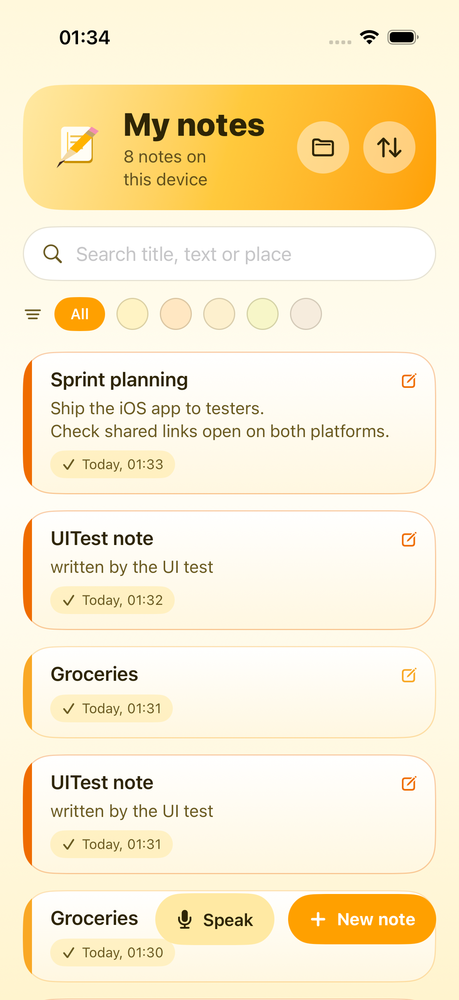
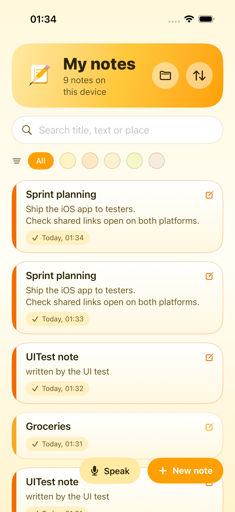
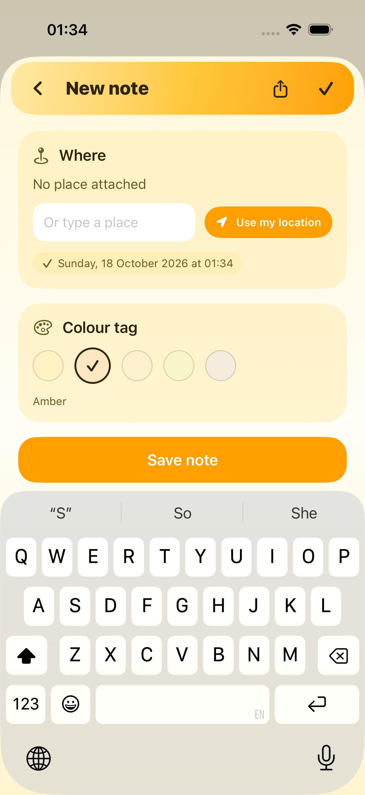

# Personal Notes — iOS

The iOS app with the same features and design as the Android app in the sibling
`personalnotes` directory: type a note, dictate it, record it, tag it with a colour, a time and
a place, keep it on the device, and send it to another user of the app as a link or a file.

SwiftUI, iOS 17+, no third-party dependencies.

<table>
<tr>
<td></td>
<td></td>
<td></td>
</tr>
</table>

## Features

| Area | What it does |
| --- | --- |
| Typing | Title + body, live editing. |
| Speaking | Live dictation through `SFSpeechRecognizer`. Partial results grow the note instead of duplicating it. On-device recognition is requested when the model is installed. |
| Recording | Voice note recorded with `AVAudioRecorder`; playback with `AVAudioPlayer`. A recording becomes permanent only when its note is saved. |
| Note fields | Title, description, created/updated time, place (coordinates + readable label), colour, kind (typed / spoken / mixed), attached recordings. |
| Local storage | JSON file in Application Support, plus an app-private attachments folder. Nothing leaves the device unless the user shares it. |
| Sharing | A `.pnote` file for the share sheet, and a self-contained deep link that carries the note itself. |
| Receiving | Deep link, tapped `.pnote` document, or the share sheet. |
| List | Search across title/text/place, colour filter, four sort orders, delete with confirmation. |

## Architecture

Clean architecture, mirroring the Android module's layering:

```
PersonalNotes/
  App/          entry point, composition root, app model
  Core/
    Domain/     models, repository protocols, use cases (no SwiftUI, no storage)
    DeepLinkParser.swift
    NotesDateFormatter.swift
  Data/         JSON store, .pnote codec, share export, CoreLocation, voice + dictation
  UI/           SwiftUI screens, design system, components
```

* `Core/Domain` is plain Swift; the use cases are unit tested with no simulator state.
* `UI` talks to `AppContainer` and the use cases, never to files or `UserDefaults`.
* `AppContainer` is a hand-written composition root: the graph is small and everything is
  constructor-injected.

### Cross-platform notes

The wire format is byte-compatible with Android's `data/codec`:

* a `.pnote` file is `PERSONALNOTES-NOTE` followed by JSON;
* a link is `personalnotes://note/d/<token>`, where the token is base64url of the note;
* Android's links are gzipped, so the iOS reader inflates both gzip and plain base64url;
* `colorId` and `kindId` use the same values (`sunbeam`, `amber`, … / `typed`, `spoken`, `mixed`);
* imports are fingerprinted on content, so receiving the same note twice stores it once.

`NotePayloadCodecTests` locks the JSON keys and decodes a payload produced outside Swift, so a
change that breaks compatibility fails the build.

## Requirements

* Xcode 16 or newer (developed against Xcode 27.1 / iOS 26.5 simulators).
* iOS 17.0 deployment target.

## Build and run

```bash
open PersonalNotes.xcodeproj          # or:
xcodebuild -project PersonalNotes.xcodeproj -scheme PersonalNotes \
  -destination 'platform=iOS Simulator,name=iPhone 17 Pro' build
```

### Regenerating the project file

`PersonalNotes.xcodeproj` is generated, not hand-edited. After adding or removing a Swift file:

```bash
python3 tools/generate_project.py
```

The script writes the project and the shared scheme, and keeps file ids deterministic so the
diff stays small.

### Tests

```bash
xcodebuild -project PersonalNotes.xcodeproj -scheme PersonalNotes \
  -destination 'platform=iOS Simulator,name=iPhone 17 Pro' test
```

* `NotePayloadCodecTests` — file/link round trips, wire-format keys, gzip from Android, base64url
  edge cases, fingerprints.
* `DeepLinkParserTests` — every link shape the app accepts, and the ones it ignores.
* `NoteUseCasesTests` — filtering, sorting, validation and timestamps.
* `NoteImportIntegrationTests` — a real Android payload imported through the file repository,
  persisted, reloaded, and not duplicated.
* `EditorFlowUITests` — writes a note through the UI, checks it appears in the list, reopens it,
  leaves with the back button, and filters the list by search.

## Deep links

| Link | Behaviour |
| --- | --- |
| `personalnotes://note/d/<token>` | The token is the whole note. |
| `personalnotes://note/<uuid>` | Opens a note already on this device (iOS notes are keyed by UUID). |
| `personalnotes.app/note/...` | Accepted in the same parser. |
| A `.pnote` document | Opened from Mail, Messages or Files. |

For automated checks there is a launch hook that delivers a link without the system "Open in"
confirmation:

```bash
xcrun simctl launch <device> com.kostovskiapps.personalnotes \
  -incomingURL "personalnotes://note/d/<token>"
```

## Permissions

Requested when first used, never at launch:

* `NSMicrophoneUsageDescription` — dictation and voice notes.
* `NSSpeechRecognitionUsageDescription` — dictation.
* `NSLocationWhenInUseUsageDescription` — optional place tag; typing a place by hand always works
  and a failed fix never blocks saving.

## Known gaps

* There is no Firebase App Distribution wiring on iOS. The Android app has it; for iOS the
  equivalent is either TestFlight or `firebase appdistribution:distribute` with an
  `GoogleService-Info.plist`, which is not set up here.
* The share sheet's system chooser is exercised through the same export path as the tests, but
  the chooser itself is not driven by an automated test.
* Reverse geocoding depends on Apple's geocoder; when it is unavailable the note keeps its
  coordinates.
* Dictation on a simulator needs a host microphone; the UI and permission flow are verified, but
  real transcription quality was not measured here.
